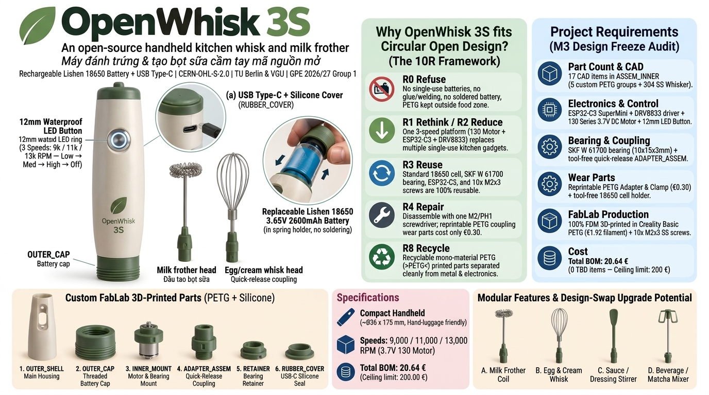

# OpenWhisk 3S — open-source handheld whisk & milk frother

**Simple · Sustainable · Serviceable.** OpenWhisk 3S is a compact, rechargeable kitchen device with one motor platform and interchangeable attachments: a **milk-frother head** and a **small whisk** for eggs, cream and light sauces. It is designed to be built in a FabLab (FDM 3D printing + simple hand assembly), repaired with one screwdriver, and modified by anyone.

> GPE Project 2026/27 — *Open Source Hardware for a Circular Economy* (TU Berlin × VGU), **Group 1**.
> Status: **M3 – design-freeze candidate (v0.3, 08 Nov 2026)**. Several functions are still being validated — see [Status & known gaps](#status--known-gaps).

*Concept visual from M1/M2 (AI-assisted rendering, not a photo of the prototype). Prototype photos are added to `images/` as they are taken.*

---

## Repository map

| Folder | What is inside | Format |
|---|---|---|
| [`cad/solidworks/`](cad/solidworks) | Original, editable design files (parts, assemblies, drawings) | SolidWorks 2021 (`.SLDPRT/.SLDASM/.SLDDRW`) |
| [`cad/step/`](cad/step) | Neutral exchange files for any CAD tool (FreeCAD, Fusion, Onshape…) | STEP AP203/AP214 |
| [`cad/stl/`](cad/stl) | Print-ready meshes of the 3D-printed parts | STL |
| [`cad/third_party/`](cad/third_party) | Links to vendor models of purchased parts (not redistributed) | Markdown |
| [`drawings/pdf/`](drawings/pdf) | Ready-to-view 2D drawings | PDF |
| [`bom/`](bom) | Bill of materials with classification, specification, cost and supplier links | XLSX (+ CSV) |
| [`electronics/`](electronics) | Block diagram, wiring table, component notes | Markdown (+ Mermaid) |
| [`firmware/`](firmware) | Firmware for the ESP32-C3 speed controller (3 speeds, LED) | Arduino C++ (MIT) |
| [`docs/`](docs) | Manufacturing, assembly, disassembly/repair, user guide, design rationale, circularity | Markdown |
| [`tests/`](tests) | Test plan and test records | Markdown |
| [`images/`](images) | Photos and renders with captions | PNG / JPG |

## Quick start — build one

1. **Print** the custom parts listed in the BOM from `cad/stl/` (settings: [`docs/manufacturing.md`](docs/manufacturing.md)).
2. **Buy** the purchased/standard items in the [BOM](bom) (motor, 18650 cell, electronics, bearing, screws).
3. **Wire** the electronics following [`electronics/wiring.md`](electronics/wiring.md) and flash the firmware from [`firmware/`](firmware).
4. **Assemble** with [`docs/assembly.md`](docs/assembly.md) — screwdriver only, no glue, no welding.
5. **Test** with [`tests/TEST_PLAN.md`](tests/TEST_PLAN.md) and record the results in `tests/records/`.

To repair or recycle it, follow [`docs/disassembly-repair.md`](docs/disassembly-repair.md).

## Key facts (v0.3)

| Item | Value | Status |
|---|---|---|
| Main functions | Foam milk; whisk/mix light liquid ingredients | Defined |
| Drive | Brushed DC motor, 130 series, 3.7 V class (target speeds 9k / 11k / 13k rpm) | Selected, bench test pending |
| Coupling | Printed ADAPTER (Ø10 mm journal in an SKF W 61700 bearing, 3 mm hex socket) + CLAMP / PUSH / SPRING quick release | CAD done, retention test pending |
| Power | 1 × 18650 Li-ion cell (Lishen LR1865SK, 2600 mAh), replaceable; USB-C charging with protection on the electronics board | Selected, runtime test pending |
| Control | ESP32-C3 SuperMini + DRV8833 driver, one push button with LED: Low → Medium → High → Off | Selected, firmware in progress |
| Housing | FDM-printed PETG | Selected |
| Food contact | Stainless-steel attachment; printed parts outside the food zone | Boundary defined, material docs pending |
| Prototype cost | **€20.64** (BOM 08 Nov 2026, estimate) — limit €200 | Estimate |
| Licence | CERN-OHL-S-2.0 (hardware) · CC BY-SA 4.0 (docs) · MIT (firmware) | Applied |

## Status & known gaps

We document decisions and failures as we go ([`CHANGELOG.md`](CHANGELOG.md)). Open items at M3:

- Motor speed/torque under load (frother and whisk) and motor temperature — bench test pending (T1, T2).
- Coupling retention, splash protection, cleanability and non-destructive disassembly — test evidence pending (T3, T5–T7).
- STEP of ADAPTER_CAP, BOARD, SPRING, BUTTON and USB-C cover; PDF drawings of RETAINER, CLAMP, PUSH, ADAPTER_CAP, BOARD.
- Firmware source for the ESP32-C3 controller.

## How to contribute / upgrade it

This repository is part of a **design swap**: another team will upgrade this product. Read [`CONTRIBUTING.md`](CONTRIBUTING.md) for folder rules, file naming and how to propose changes (fork → branch → pull request). Derived designs must stay open under the same licence.

## Licence

- **Hardware** (CAD, drawings, BOM, electronics): [CERN Open Hardware Licence Version 2 – Strongly Reciprocal](LICENSE) (`CERN-OHL-S-2.0`).
- **Documentation and images**: [Creative Commons Attribution-ShareAlike 4.0](LICENSES/CC-BY-SA-4.0.txt) (`CC-BY-SA-4.0`).
- **Firmware**: [MIT](LICENSES/MIT.txt).
- Third-party vendor models are **not** covered by these licences and are not redistributed — see [`cad/third_party/README.md`](cad/third_party/README.md).

Source location (CERN-OHL-S §4.3): https://github.com/itrecruitmentvananh-collab/Openwhisk3s

See [`NOTICE.md`](NOTICE.md) for copyright holders and how to credit the project.

## Team (Group 1)

| Member | Main role |
|---|---|
| Trần Thiên Nga | Sourcing, BOM costing, compliance QA |
| Lê Thị Vân Anh | Project management, platform, repository |
| Phạm Hoài Thương | Technical documentation, assembly manual |
| Lê Văn Đông | Requirements, mechanical CAD |
| Võ Sỹ Hùng | Testing, manufacturability |
| Ngô Hoàng Quân | Mechanical CAD |
| Trần Việt Tùng | Mechanical CAD, architecture, drive & coupling |

Lecturers: Valentin Eingartner, Felix von Amelunxen.
