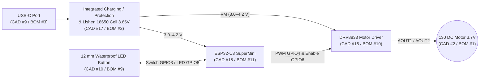

# Electronics — Block Diagram & Wiring (`BOM 08.11.2026` & `ASSEM_INNER 1046`)

## 1. Component Mapping (`ASSEM_INNER 1046.pdf` $\leftrightarrow$ `BOM 08.11.2026.xlsx`)

| CAD Item # | Part Number in Drawing | BOM No. | Model / Specification | Cost (EUR) |
| :-: | :--- | :-: | :--- | :-: |
| **2** | `MOTOR` | **1** | **DC Brushed Motor – 130 Series, 3.7 V** (3–6V, 14,500 RPM no-load) | **0.63** |
| **17** | `battery 18650+holder.stp` | **2** | **Lishen LR1865SK 18650 Li-ion, 3.65 V, 2600 mAh, 5.2 A** (in holder) | **1.22** |
| **9** | `TYPE_C.step` | **3** | **USB Type-C PCB Connector** (`RUBBER_COVER` `CAD #13` seals port when closed) | **0.06** |
| **10** | `BUTTON` | **9** | **12 mm Waterproof Momentary Push Button with LED** | **1.02** |
| **15** | `MICROCONTROLLER` | **11** | **`ESP32-C3 SuperMini`** (reads button, drives LED, outputs 3-speed PWM) | **2.20** |
| **16** | `MOTOR_DRIVER.stp` | **10** | **`DRV8833` Motor Driver Module** (`3–10 V`, `1.5 A`) | **0.52** |

## 2. Wiring Connections

| From | To | Signal / Wire | Note |
| :--- | :--- | :--- | :--- |
| `USB-C` (`CAD #9`) | Charging circuit $\rightarrow$ `18650 Holder` (`CAD #17`) | `5V VBUS` / `GND` | Protected 4.20 V Li-ion charging; cell is removable in holder |
| `18650 Holder +` (`CAD #17`) | `ESP32-C3 SuperMini` (`CAD #15`) & `DRV8833 VM` (`CAD #16`) | `VBAT+` (`3.0–4.2 V`) | Direct single-cell supply (no step-down converter needed) |
| `12mm Button Switch` (`CAD #10`) | `ESP32-C3 GPIO3` & `GND` | Momentary `NO` contact | Cycles `Low (9k) → Medium (11k) → High (13k) → Off` |
| `ESP32-C3 GPIO8` | `12mm Button LED +` (`CAD #10`) | LED indicator | Illuminated while running; blinks on low battery |
| `ESP32-C3 GPIO4 / GPIO5 / GPIO6` | `DRV8833 AIN1 / AIN2 / EEP` (`CAD #16`) | 3-speed PWM & Enable | Regulates average motor voltage (`2.5V / 3.1V / 3.65V`) |
| `DRV8833 AOUT1 / AOUT2` (`CAD #16`) | `130 Series Motor` (`CAD #2`) | Motor power leads | Detachable internal connector for solderless repair |
