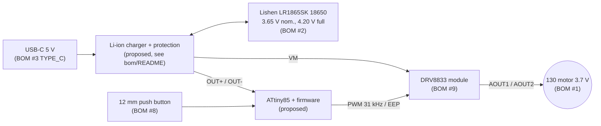

# Electronics — block diagram & wiring (v0.3, aligned with Action tracker `BOM updated`)

## Wiring table

| From | To | Wire (BOM #11) | Note |
|---|---|---|---|
| USB-C VBUS / GND | Charger IN+ / IN− | red / black 24 AWG | USB-C needs 5.1 kΩ CC resistors (usually already on charger modules) |
| Cell holder + / − | Charger B+ / B− | red / black 24 AWG | spring contacts, cell swappable, no soldering on the cell |
| Charger OUT+ | ATtiny85 pin 8 (VCC) **and** DRV8833 VM | red | 100 nF directly at ATtiny pin 8–4 |
| Charger OUT− | ATtiny85 pin 4 (GND), DRV8833 GND, button leg 2 | black | common ground |
| Button leg 1 | ATtiny85 pin 2 (PB3) | 24 AWG | internal pull-up, no resistor |
| ATtiny85 pin 3 (PB4) | DRV8833 AIN1 | 24 AWG | PWM |
| ATtiny85 pin 5 (PB0) | DRV8833 AIN2 | 24 AWG | held LOW |
| ATtiny85 pin 7 (PB2) | DRV8833 EEP / STBY / nSLEEP | 24 AWG | leave open if the module has no such pin |
| DRV8833 AOUT1 / AOUT2 | Motor terminals | red / black, JST at board | solder at motor only |

Pin details, flashing and behaviour: [`firmware/README.md`](../firmware/README.md).

## Voltage architecture (why there is no step-down converter)

| Component | Needs | From one 18650 (3.0–4.2 V) |
|---|---|---|
| Motor 130 series, 3.7 V (BOM #1, listed 3–6 V) | ≤ 3.7 V average | ✔ firmware limits the average motor voltage to 3.7 V (`MOTOR_MAX_MV`) |
| DRV8833 (BOM #9) | 2.7–10.8 V (listing: 3–10 V) | ✔ direct |
| ATtiny85 @ 8 MHz | 2.7–5.5 V | ✔ direct |
| **Mini 560 step-down 5 V (BOM #10)** | **~7–20 V input** | ✘ **not usable** (tracker J11). Proposed: remove it, or replace it with the protected USB-C charger module |

So no voltage converter is needed between the cell and the electronics. The firmware compensates for the falling cell voltage
(`duty = level_mV × 255 / cell_mV`), so the speed stays roughly constant until the cut-off at 3.2 V.

## Open checks (tests/TEST_PLAN.md)

- Motor stall/start current vs the DRV8833 rating (~1.5 A per channel; both channels can be paralleled if needed) — T1/T2, Tùng.
- Is the Lishen cell bare or protected? Treat it as **bare** until confirmed, so hardware protection (DW01-type) is mandatory — Hùng.
- Remove the power LED on the DRV8833/charger module if fitted, otherwise it drains the cell during sleep — T9.

**Safety:** never short the cell holder; use the charger module with protection; insulate all joints with heat-shrink.
