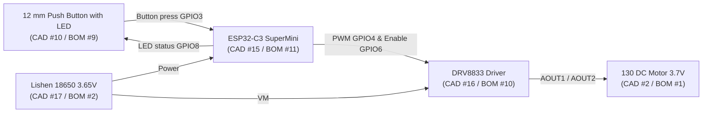

# Firmware — OpenWhisk 3S (v0.3 — ESP32-C3 SuperMini)

> **Owner:** Lê Thị Vân Anh (Documentation & Repository) · **Bench Validation:** Trần Việt Tùng & Võ Sỹ Hùng
> **Controller in `BOM 08.11.2026.xlsx` & `ASSEM_INNER 1046.pdf`:** **`ESP32-C3 SuperMini`** (`CAD #15`, `BOM #11`, **€2.20**)
> **Licence:** **MIT** (see [`LICENSE`](LICENSE)). Hardware stays under `CERN-OHL-S-2.0`.

---

## 1. What Is Firmware & Role in OpenWhisk 3S

**Firmware** is the embedded C++ program flashed onto the **`ESP32-C3 SuperMini`** microcontroller (`CAD #15`, `BOM #11`). It runs automatically whenever the `Lishen LR1865SK 18650` battery (`CAD #17`, `BOM #2`) is connected and bridges the **12 mm Illuminated Waterproof Push Button (`CAD #10`, `BOM #9`)** and the **`DRV8833` Motor Driver (`CAD #16`, `BOM #10`)**:

### Core Functions Implemented in Code:
1. **3-Speed State Cycling (`Low → Medium → High → Off`):**
   - **Press 1:** Low Speed (`~2.50 V` avg $\rightarrow$ target `~9,000 RPM` for eggs/light mixing)
   - **Press 2:** Medium Speed (`~3.10 V` avg $\rightarrow$ target `~11,000 RPM` for cream/sauces)
   - **Press 3:** High Speed (`~3.65 V` avg $\rightarrow$ target `~13,000 RPM` for milk foaming)
   - **Press 4 (or Hold $\ge 0.8\text{ s}$):** Immediate **OFF**
2. **Illuminated Button LED Control (`USE_STATUS_LED = 1`):** Lights the integrated LED on the 12 mm button (`CAD #10`) while running and blinks at `4 Hz` if the battery is low.
3. **Soft-Start Ramp (`~0.5 s`):** Prevents liquid splashing and limits start-up current spikes.
4. **Safety Auto-Off (`3 min`) & Low-Battery Cutoff (`3.20 V`):** Protects the motor and the `Lishen 18650` cell.

---

## 2. Necessary Material (Synchronized with `BOM 08.11.2026.xlsx`)

| CAD # | BOM # | Component | Specification | Cost (EUR) |
| :-: | :-: | :--- | :--- | :-: |
| **15** | **11** | **Controller / Speed Logic** | **`ESP32-C3 SuperMini`** (compact programmable MCU with onboard USB-C) | **2.20** |
| **16** | **10** | **Speed Control / Motor Driver** | **`DRV8833` motor driver module** (`3–10 V`, `1.5 A`) | **0.52** |
| **10** | **9** | **Switch / User Control** | **12 mm waterproof momentary push button with LED** | **1.02** |
| **2** | **1** | **Motor** | **DC Brushed Motor – 130 Series, 3.7 V** (`14,500 RPM` no-load) | **0.63** |
| **17** | **2** | **Battery** | **Lishen LR1865SK 18650 Li-ion** (`3.65 V`, `2600 mAh`, `5.2 A` max) | **1.22** |

---

## 3. Pin Map (`ESP32-C3 SuperMini` $\rightarrow$ `DRV8833` & `12 mm LED Button`)

| `ESP32-C3 SuperMini` Pin | Signal | Connected To |
| :--- | :--- | :--- |
| **5V / VBUS or 3V3** | Power Supply | Battery / Charger `OUT+` |
| **GND** | Common Ground | `DRV8833 GND`, Button Contact `GND`, Button LED `-` |
| **GPIO3** | Button Input | 12 mm Push Button Switch Contact (`NO` pin, internal pull-up enabled) |
| **GPIO8** | Button LED Output | 12 mm Push Button `LED +` pin (lights while running, blinks on low battery) |
| **GPIO4** | Motor PWM | `DRV8833 AIN1` |
| **GPIO5** | Motor Direction | `DRV8833 AIN2` (held `LOW`) |
| **GPIO6** | Driver Enable | `DRV8833 EEP / STBY / nSLEEP` (`HIGH` when active, `LOW` in standby) |
| **GPIO2 (ADC1_CH2)** | Battery Sense | Optional voltage divider (`2× 100 kΩ`) to monitor `18650` voltage |

---

## 4. Material Created in This Folder

| File | Description |
| :--- | :--- |
| [`OpenWhisk3S_Firmware/OpenWhisk3S_Firmware.ino`](OpenWhisk3S_Firmware/OpenWhisk3S_Firmware.ino) | Main Arduino sketch (supports `ESP32-C3 SuperMini`, `ATtiny85`, and `Arduino Uno/Nano`). |
| [`OpenWhisk3S_Firmware/config.h`](OpenWhisk3S_Firmware/config.h) | Pin mapping for `ESP32-C3 SuperMini` (`GPIO3/4/5/6/8`) and speed/safety constants. |
| [`OpenWhisk3S_Firmware/speed_logic.h`](OpenWhisk3S_Firmware/speed_logic.h) | Hardware-independent state machine (short press, long press, soft start, auto-off, low-battery cutoff). |
| [`test/test_speed_logic.cpp`](test/test_speed_logic.cpp) | 19 automated PC unit-test checks verifying the state machine. |
| [`LICENSE`](LICENSE) | MIT Licence text. |

---

## 5. How to Flash `ESP32-C3 SuperMini` (Direct USB-C — No External Programmer Needed!)

Because your team selected the **`ESP32-C3 SuperMini`** (`CAD #15`), you do **not** need an external ISP programmer—the `ESP32-C3 SuperMini` has a **built-in USB-C port** for direct programming:
1. Install **Arduino IDE 2.x** and add the official **esp32 by Espressif Systems** board package in *Boards Manager*.
2. Select **Tools $\rightarrow$ Board $\rightarrow$ ESP32C3 Dev Module** (and enable *USB CDC On Boot: Enabled*).
3. Connect the `ESP32-C3 SuperMini` to your laptop with a USB-C cable (if uploading for the first time, hold the `BOOT` button while pressing `RST`).
4. Open `OpenWhisk3S_Firmware/OpenWhisk3S_Firmware.ino` and click **Upload**.
