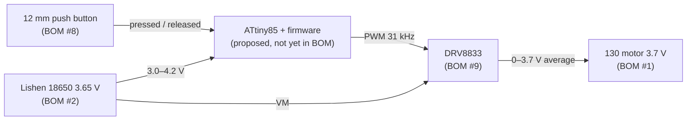

# Firmware — OpenWhisk 3S (v0.1)

> Owner (documentation & repository): **Vân Anh** · Bench validation: **Tùng** (motor, Action #5) and **Hùng** (battery/runtime, Action #7)
> Licence of everything in this folder: **MIT** (see [`LICENSE`](LICENSE)). The hardware stays under CERN-OHL-S-2.0.
> Status: **code written, not yet flashed or bench-tested.** Results go to `tests/records/firmware_*.md` (test T9).

---

## 1. What is firmware?

**Firmware** is the small program stored *inside* a microcontroller chip. It runs on its own as soon as the
device gets power. It is not an app and it doesn't need a computer. In OpenWhisk 3S it has one job:

> **Turn presses of the single 12 mm button into 3 motor speeds, safely.**

| Without firmware | With firmware |
|---|---|
| Button = on/off only (motor runs at full battery voltage, 4.2 V when full) | Press 1 = speed 1 · press 2 = speed 2 · press 3 = speed 3 · press 4 = off |
| Motor speed falls as the battery drains | Speed is held roughly constant (voltage compensation) |
| Battery can be drained too deep | Motor stops at low battery, cell is protected |
| Motor starts with a jolt and splashes | Soft start (~0.5 s ramp) |
| Device can be left running | Auto-off after 3 min; ~1 µA deep sleep when off |

## 2. Why the Action tracker BOM needs firmware

The `BOM updated` sheet in `Action tracker.xlsx` selects:

| BOM # | Item (from tracker) | What it can do by itself |
|---|---|---|
| 8 | 12 mm waterproof **momentary** push button, IP65, non-LED, "electronic 3-speed selection" | Only closes a contact while pressed (the `Figure` sheet shows a plain 2-pin NO switch). It can't store a speed. |
| 9 | **DRV8833** motor driver module (3–10 V, ~1.5 A) | A power switch (H-bridge). It drives the motor **only when it receives a PWM signal** on IN1/IN2. It doesn't decide the speed. |
| 1 | DC brushed motor 130 series, 3.7 V | Its speed depends on the average voltage it receives. |

Something has to sit **between** the button and the DRV8833. It counts the presses and produces the PWM signal.
That "something" is a microcontroller with this firmware. It provides the "electronic 3-speed selection" written
in BOM #8.



> [!IMPORTANT]
> The microcontroller is **not yet a line in the tracker BOM** and has no price. It's listed under *Proposed additions*
> in [`bom/README.md`](../bom/README.md) for Nga to quote (Action #3) and for Tùng to check against the part count (Action #1).
> It's a standard electronic component, like the DRV8833. Whether it counts toward the "≤ 2 purchased parts" limit has to be confirmed with the lecturers.

## 3. Necessary material

### 3.1 Hardware for the device (per unit)

| Item | Purpose | In tracker BOM? |
|---|---|---|
| ATtiny85-20PU (DIP-8) + 8-pin IC socket | Runs the firmware. The socket lets you remove and re-flash the chip (repairability) | **No – proposed** |
| 100 nF ceramic capacitor (VCC–GND, close to the chip) | Keeps the supply stable during motor switching | **No – proposed** (cents) |
| DRV8833 module | Motor power stage | Yes (#9) |
| 12 mm momentary push button | User input | Yes (#8) |
| Lishen LR1865SK 18650 + protected charger module (USB-C, Li-ion CC/CV 4.2 V, with DW01-type protection) | Power + safe charging | Cell yes (#2). Connector yes (#3, "TYPE_C"). The **charger circuit is not yet in the BOM** (tracker J4 asks for exactly this) |
| 130 motor, 24 AWG silicone wire + JST | Drive, wiring | Yes (#1, #11) |
| Optional: 3 mm LED + 1 kΩ resistor | Low-battery blink (`USE_STATUS_LED 1`) | No – optional |

### 3.2 Tools to program the chip (one set for the whole team, reusable)

| Tool | Note |
|---|---|
| PC with **Arduino IDE 2.x** | Free: https://www.arduino.cc/en/software |
| **ATTinyCore** board package (Spence Konde) | Adds ATtiny85 support. Board manager URL: `http://drazzy.com/package_drazzy.com_index.json` |
| Programmer: an **Arduino Uno/Nano** used as "Arduino as ISP" (+ 10 µF capacitor RESET–GND on the Uno), **or** a USBasp | Writes the program into the chip |
| Breadboard + jumper wires | For flashing and the bench test |
| Multimeter | Calibrates the voltage measurement and measures motor current (T1/T2) |

## 4. Material created (contents of this folder)

| File | What it is |
|---|---|
| [`OpenWhisk3S_Firmware/OpenWhisk3S_Firmware.ino`](OpenWhisk3S_Firmware/OpenWhisk3S_Firmware.ino) | Main program (hardware layer): 31.25 kHz PWM on Timer1, battery-voltage measurement with the internal 1.1 V reference (no extra parts), deep sleep with wake-on-button |
| [`OpenWhisk3S_Firmware/speed_logic.h`](OpenWhisk3S_Firmware/speed_logic.h) | The control logic: debounce, short/long press, 3 speed levels, soft start, low-battery lock-out, auto-off. It has no hardware code, so it can be tested on a PC |
| [`OpenWhisk3S_Firmware/config.h`](OpenWhisk3S_Firmware/config.h) | **All settings in one place**: pins, speed levels, thresholds, timings |
| [`test/test_speed_logic.cpp`](test/test_speed_logic.cpp) | PC unit test of the logic (19 checks) |
| [`LICENSE`](LICENSE) | MIT licence for the firmware |

## 5. How it behaves

| User action | Result |
|---|---|
| Short press while off | Speed 1 (soft start) |
| Short press while running | Speed 1 → 2 → 3 → off |
| Hold ≥ 0.8 s | Off immediately, from any speed |
| Cell < 3.2 V for 2 s while running | Motor stops. Device stays locked until the cell is charged above 3.6 V |
| Running 3 min without a press | Auto-off |
| Off for 3 s | Deep sleep (~1 µA chip current). The next press wakes it and starts speed 1 |

**Speed levels are set as average motor voltage**, not as a fixed PWM %:
`duty = level_mV × 255 / cell_mV` (limited to the motor's 3.7 V rating). Defaults: **2.0 V / 2.8 V / 3.6 V**.
The rpm per level is **not claimed**. The M2 target direction (~9,000 / 11,000 / 13,000 rpm) has to be measured
in test T1/T2 and the levels tuned in `config.h`.

## 6. Pin map (ATtiny85)

| ATtiny85 pin | Signal | Connect to |
|---|---|---|
| 8 VCC | supply | charger/protection **OUT+** (= cell +) and 100 nF to GND |
| 4 GND | ground | common GND (charger OUT−, DRV8833 GND, button) |
| 2 PB3 | button | button leg 1. Button leg 2 → GND (internal pull-up, no resistor) |
| 3 PB4 | PWM | DRV8833 **AIN1** |
| 5 PB0 | direction | DRV8833 **AIN2** (held LOW) |
| 7 PB2 | driver enable | DRV8833 **EEP / STBY / nSLEEP**. If your module has no such pin, leave PB2 open |
| 6 PB1 | optional LED | LED + 1 kΩ to GND (only if `USE_STATUS_LED 1`) |
| 1 PB5 | RESET | only used while programming |

DRV8833: **VM** → charger OUT+, **AOUT1/AOUT2** → motor. Full wiring: [`electronics/wiring.md`](../electronics/wiring.md).

## 7. How to flash (step by step)

1. Install Arduino IDE 2.x → *File → Preferences → Additional boards manager URLs* → add the ATTinyCore URL above → *Boards Manager* → install **ATTinyCore**.
2. Turn the Uno into a programmer: open *File → Examples → 11.ArduinoISP → ArduinoISP*, select board *Arduino Uno*, upload.
3. Wire Uno → ATtiny85: D13→pin 7 (SCK), D12→pin 6 (MISO), D11→pin 5 (MOSI), D10→pin 1 (RESET), 5V→pin 8, GND→pin 4. Add 10 µF between Uno RESET and GND.
   *(Take the ATtiny out of the device for this. Don't connect the battery while it's on the Uno.)*
4. *Tools*: Board **ATtiny25/45/85 (No bootloader)**, Chip **ATtiny85**, Clock **8 MHz (internal)**, millis **enabled**, Programmer **Arduino as ISP**.
5. *Tools → Burn Bootloader* once. This only sets the 8 MHz clock fuses.
6. Open `OpenWhisk3S_Firmware/OpenWhisk3S_Firmware.ino` → *Sketch → Upload Using Programmer*.
7. Put the chip back into its socket in the device.

**Bench option without an ATtiny:** select *Arduino Uno*, upload normally. Pins: button D2, AIN1 D9, AIN2 D8, EEP D7.
The Uno has no deep sleep and uses `BENCH_VBAT_MV` instead of measuring the cell.

## 8. Calibration (once per chip, 2 min)

The internal 1.1 V reference varies ±10 % between chips:
1. Run the device from a lab power supply (or a partly empty cell) and lower the voltage slowly while the motor runs at speed 1.
2. Note the **real** voltage (multimeter) at which the motor stops. It should be 3.20 V.
3. In `config.h`, correct `BANDGAP_MV` by the ratio. Example: it stops at a real 3.35 V → `BANDGAP_MV = 1100 × 3.20 / 3.35 ≈ 1051`. Re-flash.
4. Record the value in `tests/records/firmware_*.md`.

## 9. PC unit test (optional, no hardware)

```
cd firmware/test
g++ -std=c++11 -I../OpenWhisk3S_Firmware test_speed_logic.cpp -o test_logic
./test_logic          (Windows: test_logic.exe)
```
Expected last line: `ALL TESTS PASSED (0 failure(s))`. *(Not yet run by the team: no compiler on the documentation PC.)*

## 10. Safety notes

- Firmware protection is a **second layer**. The cell must also have hardware protection (DW01-type on the charger module, or a protected cell). Tracker BOM #2 J-column asks whether the Lishen cell is bare or protected. Treat it as **bare** until confirmed.
- The motor's stall current must stay below the DRV8833 rating (tracker BOM #9 J-column). Check in test T1/T2.
- The tracker found that the **Mini 560 step-down module (BOM #10) can't work from one 3.65 V cell** (it needs ~7–20 V in). This firmware architecture doesn't need it: the motor (3.7 V class), the DRV8833 (3–10 V) and the ATtiny85 (2.7–5.5 V) all run directly from the cell.

## 11. Future versions

Battery-level indication, a "pulse" mode, current sensing for stall protection (needs a shunt resistor), USB-C charge-state display.
Contributions via pull request. Please keep them under MIT.
